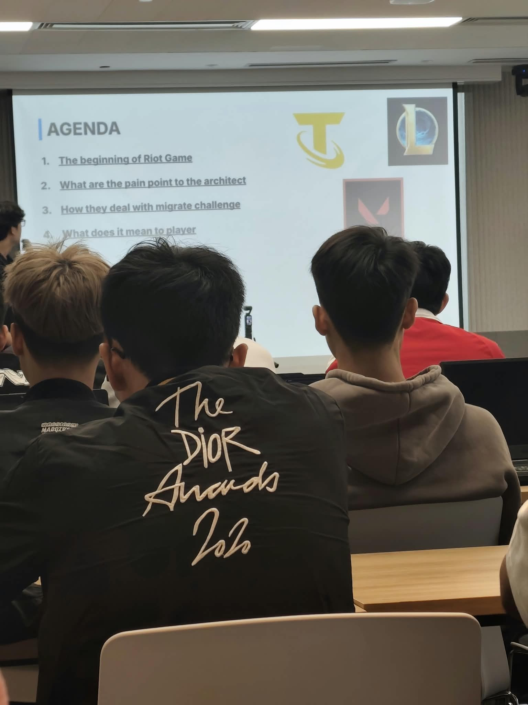
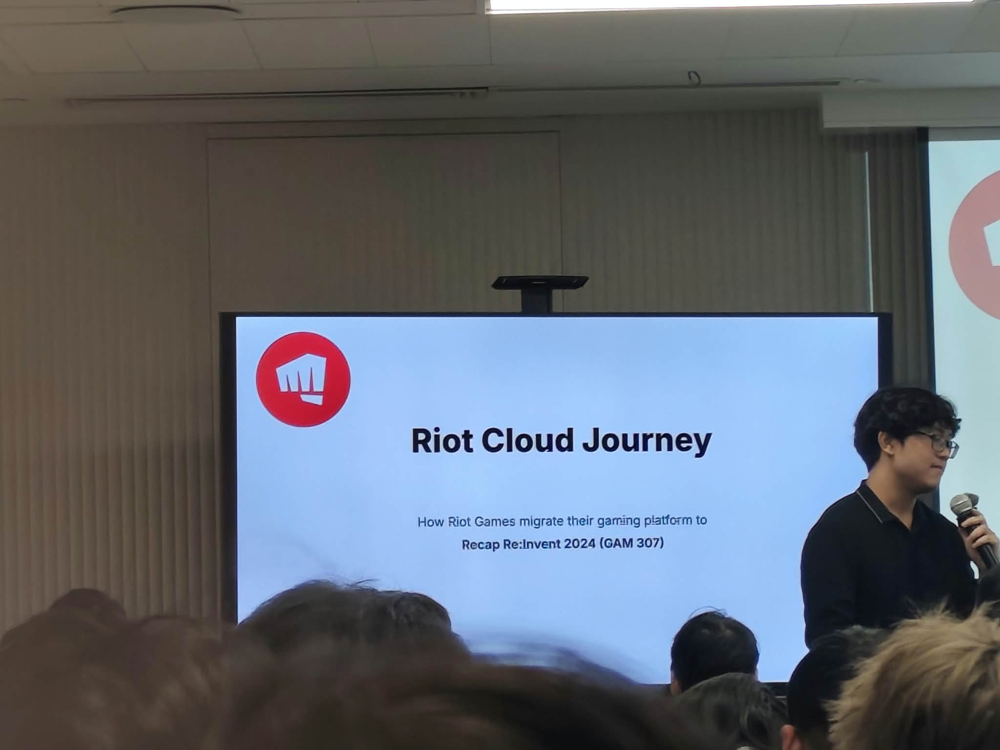
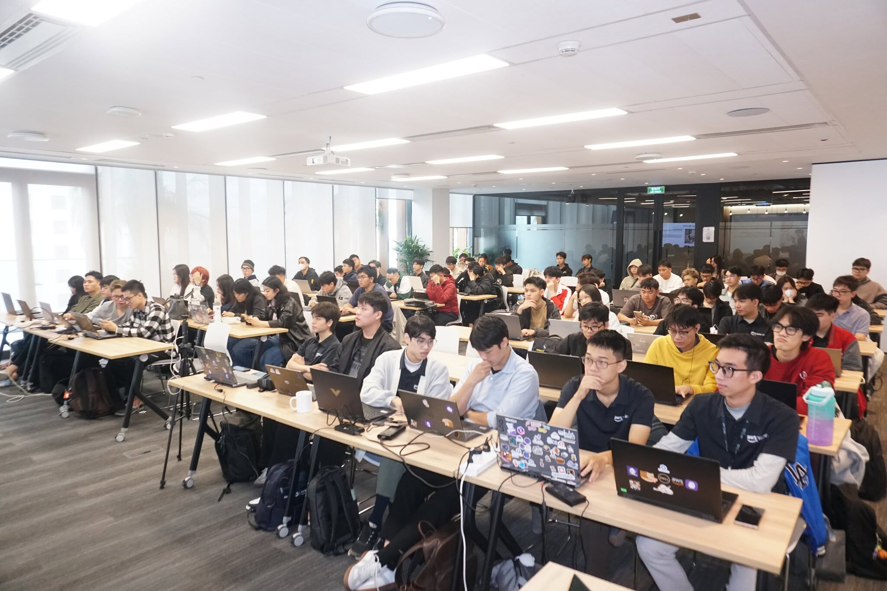

# Event Summary: “FCAJ Community Day”

### Event Overview
*   **Event Title**: FCAJ Community Day
*   **Date**: November 14, 2026
*   **Location**: Grand Terra Tower, 36 Cát Linh, Đống Đa, Hà Nội (AWS Vietnam Office)
*   **Organizer**: AWS Study Group in collaboration with FCAJ Community
*   **Role**: Participant

---

### Event Objectives
*   **Program Goal**: Riot Games’ journey into the clouds.
*   **Core Message**: Explore the difficulties and challenges of operating game server infrastructure, how Riot Games designed its cloud architecture to meet system requirements, the journey of migrating to the cloud, and the technical challenges encountered during implementation.
*   **Value for Participants**: Provide attendees with a practical perspective on Cloud Architecture, Infrastructure, and Migration through an engaging case study from AWS re:Invent 2024.

---

### Key Highlights

#### 1. Real-World Challenges
Behind games that serve millions of players lies a complex infrastructure. So, how has Riot Games tackled the challenges of operations and the transition to the cloud?

---

### Key Learnings

#### 1. Mindset & Methodology
To operate games that serve millions of users simultaneously, Riot has had to implement an incredibly complex system.

#### 2. Technical Knowledge
*   Understood the core concepts of **Cloud Architecture**.
*   How to operate game server infrastructure.
*   Understand the cloud migration process and the technical challenges encountered during implementation.

---

### Workplace Application
*   **Current Project Application**: Gain a better understanding of how the games played by millions of users today—from Riot—actually operate.
*   **Future Technologies to Test**: Research AWS-native AI solutions to build intelligent, self-healing Cloud systems that automate operations and lower costs.
*   **Networking and connection**: An opportunity to engage with others interested in Riot Games, broaden your knowledge, and gain practical experience in the field of Cloud Architecture.

---

### Event Impressions & Photos

