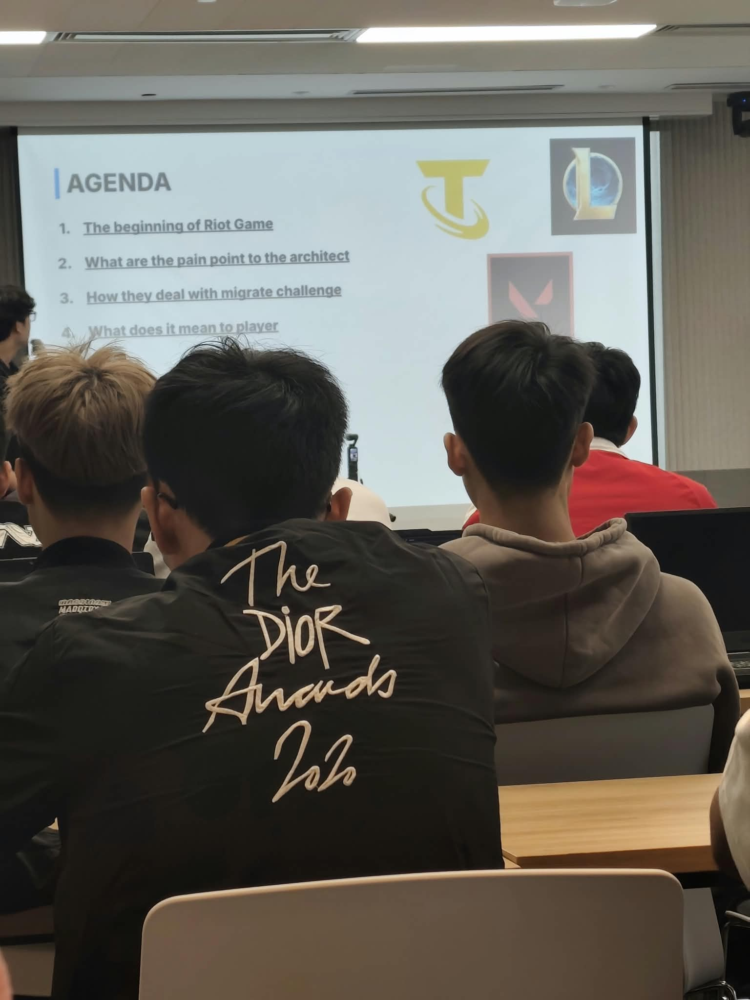
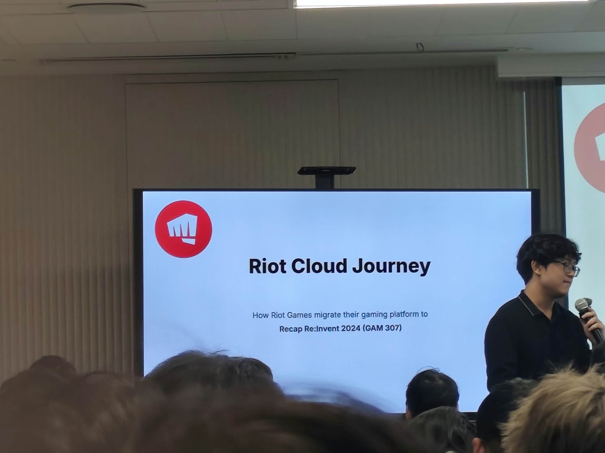
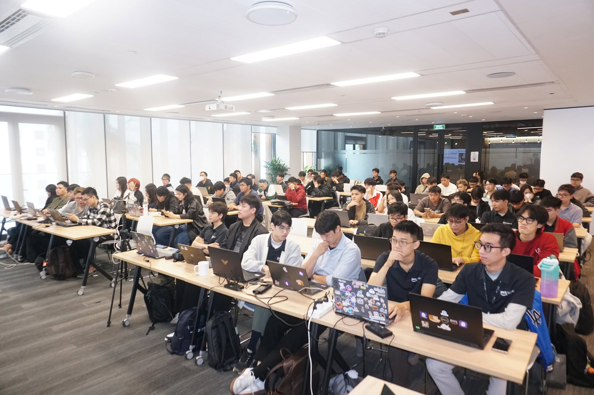

# Bài thu hoạch “FCAJ Community Day”

### Thông tin chung về sự kiện
*   **Tên Sự Kiện**: FCAJ Community Day
*   **Thời gian tổ chức**: 14-11-2026
*   **Địa điểm tổ chức**: Grand Terra Tower, 36 Cát Linh, Đống Đa, Hà Nội (AWS Vietnam Office)
*   **Đơn vị tổ chức**: AWS Study Group phối hợp cùng cộng đồng FCAJ
*   **Vai trò tham gia**: Người tham dự

---

### Mục đích của sự kiện
*   **Mục tiêu của chương trình**: Hành trình lên mây của Riot Games.
*   **Nội dung chính muốn truyền tải**: Tìm hiểu những khó khăn và thách thức khi vận hành hạ tầng máy chủ game, Cách Riot Games thiết kế kiến trúc Cloud để đáp ứng yêu cầu của hệ thống, hành trình chuyển đổi lên Cloud và những thách thức kỹ thuật trong quá trình triển khai.
*   **Giá trị dành cho người tham dự**: Giúp người tham dự có thêm góc nhìn thực tế về Cloud Architecture, Infrastructure và Migration thông qua một case study thú vị từ AWS re 2024.
---

### Nội dung nổi bật

#### 1. Tổng quan vấn đề thực tế
Đằng sau những tựa game phục vụ hàng triệu người chơi là một hệ thống hạ tầng phức tạp. Vậy Riot Games đã giải quyết những bài toán về vận hành và chuyển đổi lên Cloud như thế nào?

---

### Những gì học được

#### 1. Tư duy và phương pháp
* Hiểu được để vận hành được những tựa game phục vụ hàng triệu người dùng cùng lúc Riot đã phải trang bị 1 hệ thống vô cùng phức tạp. 
* Cách Riot Games thiết kế kiến trúc Cloud để đáp ứng nhu cầu của hệ thống.
#### 2. Kiến thức kỹ thuật
*   Hiểu khái niệm **Cloud Architecture**.
*   Cách vận hành hạ tầng máy chủ game.
*   Nắm được quy trình chuyển đổi lên Cloud và những thách thức kỹ thuật trong quá trình triển khai.

---

### Trải nghiệm trong sự kiện
*   **Học hỏi từ chương trình**: Hiểu rõ hơn về cách vận hành những tựa game được hàng triệu người dùng hiện nay từ Riot.
*   **Giao lưu và kết nối**: Có cơ hội trao đổi với những người quan tâm đến Riotgames, mở rộng kiến thức cũng như học hỏi thêm nhiều kinh nghiệm thực tế trong lĩnh vực Cloud Architecture.

---

### Bài học rút ra
*   **Kiến thức quan trọng nhất**: Đằng sau những tựa game phục vụ hàng triệu người chơi là một hệ thống hạ tầng phức tạp. 
*   **Kinh nghiệm thực tế**: Việc kết hợp giữa kỹ năng chuyên môn và AI sẽ giúp nâng cao năng suất làm việc, giảm các tác vụ thủ công và tối ưu quy trình quản trị hạ tầng Cloud.
*   **Định hướng học tập tiếp theo**: Tiếp tục tìm hiểu về Cloud Architecture, Infrastructure và Migration và các dịch vụ AI trên AWS để nâng cao kỹ năng triển khai, quản trị và vận hành hệ thống Cloud trong thực tế.

---

### Một số hình ảnh khi tham gia sự kiện

