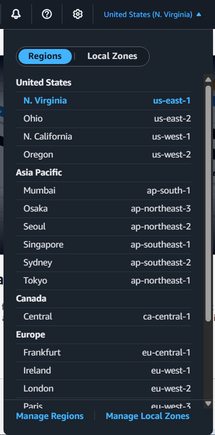

# 4.1. Prerequisites & Region Setup

### Prerequisites:
1.  An **AWS Account** with Administrator Access or an IAM user with full permissions for Amazon Cognito, DynamoDB, Lambda, API Gateway, EC2, S3, CodeDeploy, and IAM.
2.  A modern **Web Browser** (Google Chrome, Firefox, Safari, or Microsoft Edge).
3.  An API testing tool (Postman, cURL, or a Node.js client script) to simulate player API requests.

---

### Step 1: Console Login & Region Selection
1. Access the [AWS Management Console](https://console.aws.amazon.com/) and log in to your account.
2. In the top-right navigation bar, switch your AWS Region to **Asia Pacific (Singapore) - ap-southeast-1**.

