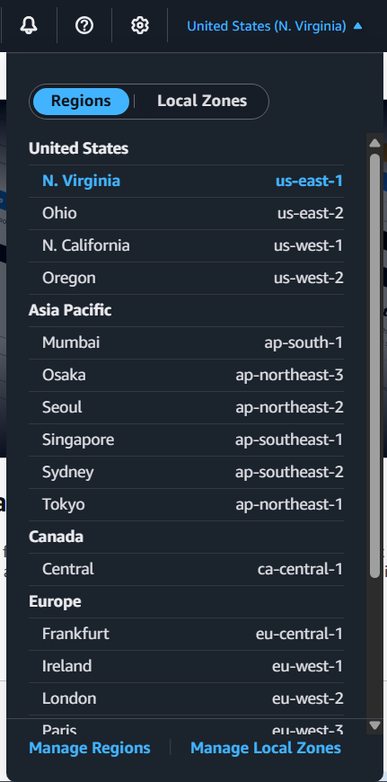

# 4.1. Chuẩn bị Môi trường & Thiết lập Region

### Yêu cầu tiên quyết:
1.  **Tài khoản AWS (AWS Account)** có quyền quản trị (Administrator Access) hoặc IAM User có đầy đủ quyền thao tác trên Cognito, DynamoDB, Lambda, API Gateway, EC2, S3, CodeDeploy và IAM.
2.  **Trình duyệt web** (Google Chrome, Firefox, Safari hoặc Microsoft Edge).
3.  **Client/Kịch bản kiểm thử**: Postman, cURL hoặc ứng dụng Node.js để gửi request API.

---

### Bước 1: Đăng nhập Console và Chuyển Region
1. Truy cập [AWS Management Console](https://console.aws.amazon.com/) và đăng nhập tài khoản của bạn.
2. Trên góc trên bên phải thanh điều hướng, chọn Region **Asia Pacific (Singapore) - ap-southeast-1**.

